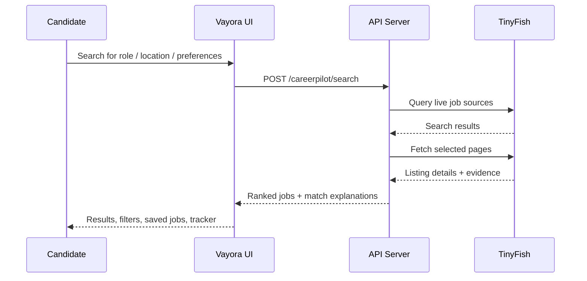

# Vayora — Your next move, made with confidence.

Vayora by Byte Force is a desktop-first job discovery and career workspace for students and early-career professionals. This TypeScript monorepo combines a React frontend, an Express API, generated API clients, schema validation, and live external job intelligence powered by TinyFish.

<p align="center">
  
  
  
  
  
</p>

## Overview

Vayora helps users:

- discover jobs and internships from live sources
- compare opportunities against their profile and preferences
- understand match quality and verification signals
- save interesting roles and track application progress
- verify whether a role is still live and credible

The app is designed to be factual and source-aware, instead of fabricating positions or scores. It keeps user data local in the browser by default and uses a server-side TinyFish API key for live enrichment.

The Career Studio adds a browser-local Master Profile, evidence-based job comparison, editable job-specific resume drafts with print/PDF export, application and outreach email drafts, and links to existing tracker records. Optional Gemini generation, Gmail sending, and consent-gated TinyFish form assistance are available when their server-side credentials are configured. All drafts remain editable; Vayora never submits an application.

---

## Architecture at a glance


---

## Project code structure

```text
Byte-Force/  # team workspace
├── artifacts/
│   ├── api-server/
│   │   ├── src/
│   │   │   ├── app.ts
│   │   │   ├── index.ts
│   │   │   ├── lib/
│   │   │   ├── middlewares/
│   │   │   └── routes/
│   │   │       ├── careerpilot.ts
│   │   │       ├── careerpilot-service.ts
│   │   │       ├── health.ts
│   │   │       └── index.ts
│   │   ├── build.mjs
│   │   ├── package.json
│   │   └── tsconfig.json
│   ├── careerpilot/
│   │   ├── src/
│   │   ├── public/
│   │   ├── package.json
│   │   ├── vite.config.ts
│   │   └── tsconfig.json
│   └── mockup-sandbox/
│       └── ...
├── lib/
│   ├── api-client-react/
│   ├── api-spec/
│   ├── api-zod/
│   └── ...
├── db/
│   ├── src/
│   ├── drizzle.config.ts
│   └── package.json
├── scripts/
│   ├── src/
│   └── post-merge.sh
├── package.json
├── pnpm-lock.yaml
├── pnpm-workspace.yaml
├── replit.md
├── tsconfig.base.json
├── tsconfig.json
└── README.md
```

### Main application areas

- `artifacts/careerpilot/` — React + Vite frontend for job discovery, filtering, saved jobs, tracker, and preferences
- `artifacts/api-server/` — Express server and live job-search endpoints
- `artifacts/api-server/src/routes/careerpilot-service.ts` — TinyFish integration for search, fetch, and verification logic
- `lib/api-spec/openapi.yaml` — source-of-truth API contract
- `lib/api-client-react/` — generated React Query client from the OpenAPI spec
- `lib/api-zod/` — shared validation and request/response Zod schemas
- `db/` — Drizzle schema and database tooling
- `scripts/` — repo automation and merge helpers

---

## Tech stack

### Frontend

- React
- Vite
- TypeScript
- Tailwind-inspired styling system
- Radix UI primitives for accessible components
- Wouter for routing
- TanStack React Query for async data handling
- Recharts, motion, icons, form utilities, toast UI

### Backend

- Node.js
- TypeScript
- Express 5
- Pino structured logging
- Drizzle ORM with PostgreSQL support
- Zod-based validation and request shaping

### Tooling and platform

- pnpm workspaces
- TypeScript project references
- esbuild for server bundling
- OpenAPI + Orval code generation
- Replit-ready dev environment and deployment settings

---

## TinyFish integration

TinyFish is a core part of the product's live job intelligence flow.

- `TINYFISH_API_KEY` is expected as a server-side secret
- the backend exposes routes for status, search, and verification
- TinyFish Search finds candidate job pages
- TinyFish Fetch reads the live listing content
- TinyFish Agent can be used for deeper verification when evidence is uncertain
- all TinyFish calls are intentionally kept server-side to avoid exposing credentials in the browser

This makes the app resilient and keeps the search layer grounded in current live source pages rather than static or guessed data.



---

## Product flow

1. The user enters a desired role, location, and profile preferences.
2. The frontend sends the search request to the API server.
3. The API calls TinyFish to discover relevant roles and fetch live listing pages.
4. Results are normalized, deduplicated, and scored against the user profile.
5. The user can save jobs, track applications, and verify live listing status.
6. Sensitive API credentials remain on the server, while personal tracking stays local in the browser.

---

## Setup and run

### Prerequisites

- Node.js 24+
- pnpm
- a valid TinyFish API key in the environment or Replit secrets
- optional PostgreSQL connection for database-backed features

### Common commands

Start the API server and frontend in separate terminals from the repository root:

```bash
pnpm install
```

Terminal 1 (API server):

```bash
PORT=5055 pnpm --filter @workspace/api-server run dev
```

Set `TINYFISH_API_KEY` as a server-side environment secret before starting the API server. Do not paste keys into commands that are saved in shell history. For local development, create `artifacts/api-server/.env` and set credentials there; that file is ignored by Git and loaded automatically. Never copy real credentials into a tracked example file.

Optional integrations:

- `GEMINI_API_KEY` enables Gemini-generated resume, application-email, and outreach drafts. The UI asks before sharing the selected profile and job facts with Google. Verify every generated claim.
- `GOOGLE_CLIENT_ID`, `GOOGLE_CLIENT_SECRET`, and `GOOGLE_REDIRECT_URI` enable Gmail OAuth. Create a Google OAuth web client and register `http://localhost:5055/api/careerpilot/gmail/oauth/callback` as an authorized redirect URI. Gmail access is limited to `gmail.send`; tokens are kept in memory for this local server session, so reconnect after restarting the API. Each send requires a separate confirmation and sends plain text only (no attachments).
- `GEMINI_MODEL` optionally selects a Gemini model; defaults to `gemini-2.5-flash`.
- `CAREERPILOT_FRONTEND_URL` optionally sets the frontend URL used after Gmail authorization; defaults to `http://localhost:4173`.

Terminal 2 (frontend):

```bash
PORT=4173 BASE_PATH=/ API_SERVER_URL=http://127.0.0.1:5055 pnpm --filter @workspace/careerpilot run dev
```

The Vite development server forwards `/api` requests to the API server. Set `API_SERVER_URL` if the API server is listening elsewhere. For deployment, configure `TINYFISH_API_KEY` as a server-side secret; never put it in frontend code or commit it.

Run checks and production builds from another terminal:

```bash
pnpm run typecheck
pnpm run build
```

### Required environment variables

```bash
PORT=5055                  # API server; use 4173 for the frontend's Vite dev server
BASE_PATH=/                # required by the frontend's Vite config
API_SERVER_URL=http://127.0.0.1:5055  # optional; defaults to this local API address
TINYFISH_API_KEY=           # server only; set in artifacts/api-server/.env or secret environment
GEMINI_API_KEY=             # optional; server only
GEMINI_MODEL=gemini-2.5-flash
GOOGLE_CLIENT_ID=           # optional Gmail OAuth web client
GOOGLE_CLIENT_SECRET=       # optional; server only
GOOGLE_REDIRECT_URI=http://localhost:5055/api/careerpilot/gmail/oauth/callback
CAREERPILOT_FRONTEND_URL=http://localhost:4173
DATABASE_URL=postgresql://...  # optional for DB-backed work
```

### Chrome Job Companion

The Manifest V3 extension source is in `artifacts/careerpilot-extension/`. In Chrome, open `chrome://extensions`, enable Developer mode, choose **Load unpacked**, and select that directory. Keep Vayora running at `http://localhost:4173` and open a tab with the saved Master Profile. The companion suggests a visible page heading and description for capture; confirm the title and company before opening the job in Career Studio. Job-description text is used to compare the listing with verified Master Profile skills.

For application forms, explicitly consent to local inspection, review the suggested field/value pairs, select only the entries you approve, and then fill those blank text fields. A second check ensures a field is still blank and still matches its reviewed label. The companion never answers legal/eligibility questions, selects checkboxes or menus, uploads a file, or submits the form. Sites may autosave field changes; review the employer page before continuing. A job-specific saved resume can be opened in Career Studio from the extension; use **Print / Save as PDF** there and attach the reviewed file yourself if the employer requests an upload. Chrome does not allow this extension to populate a site's file picker.

Master Profile accepts selectable-text PDFs up to 10 MB and 20 pages. Text extraction and suggestions run in the browser; scanned PDFs without a text layer require manual entry/OCR elsewhere. Review suggestions, apply them only to empty fields, edit the profile, and explicitly save. The uploaded source PDF is not retained.

Career Studio stores cover-letter drafts per job. Recruiter, hiring-manager, and referral outreach templates use the selected job and saved facts; verify contact details yourself, save drafts, and optionally schedule follow-up dates. Follow-ups appear on the corresponding application-tracker record when the outreach draft is linked. Vayora does not invent a contact or claim a message was sent unless Gmail confirms the send or you mark a contact as made.

TinyFish application assistance uses a separate remote TinyFish Agent browser and may consume paid Agent credits. It starts only after consent, is rate-limited, and is instructed not to submit, upload documents, or answer legal/eligibility questions. A remote run does not automatically fill the page open in local Chrome. Use the local companion for per-field review, and submit manually on the employer site only after checking all answers. If a site requires authentication, CAPTCHA, file upload, or another unsupported control, use the employer URL and prepared Career Studio materials as the manual fallback.

---

## Notes on the current build

This repo is a workspace-based system with a strong emphasis on a live search and verification workflow. The front-end is intentionally desktop-first, and the saved jobs / preference data currently persist in browser local storage rather than a multi-user backend account system.

The Master Profile, saved resume versions, cover-letter/email/outreach drafts, tracker, saved jobs, and search preferences use this browser's local storage by default and are not account-synced. PDF text extraction happens locally; only explicitly confirmed Gemini generation or TinyFish form assistance sends selected profile/job facts to those providers. A Gmail send transmits the reviewed message through Google. Clearing browser data removes local records, so export/copy important materials before clearing it.

The codebase emphasizes:

- reliability over randomness
- evidence-based job matching
- explicit source verification
- developer-friendly generated API contracts
- a clear separation between frontend state and server-side API concerns

---

## Status

Vayora is the career discovery and application workspace built by Byte Force. The project is structured as a monorepo for a real-world hiring-assistant experience with a live data layer, generated contracts, and a polished UI. It is well-suited for continued expansion into richer analytics, saved account sync, job alerts, or deeper recruiter workflows.
