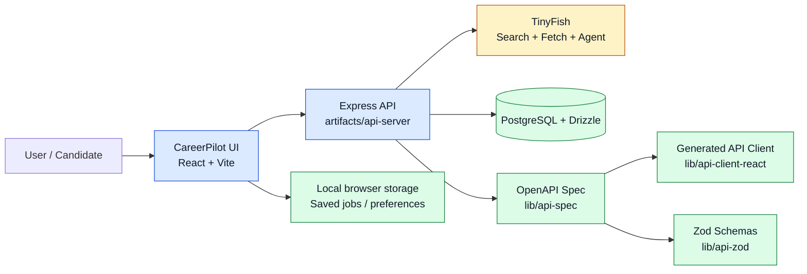
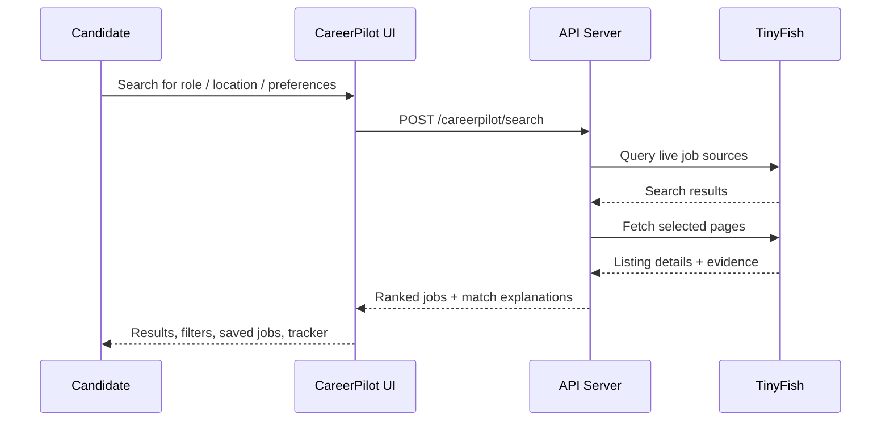

# Career-Pilot

Byte Force is the team behind Career-Pilot, a TypeScript monorepo centered on a desktop-first job discovery and verification platform for students and early-career professionals. The project combines a React frontend, an Express API, generated API clients, schema validation, and live external job intelligence powered by TinyFish.

<p align="center">
  
  
  
  
  
</p>

## Overview

CareerPilot helps users:

- discover jobs and internships from live sources
- compare opportunities against their profile and preferences
- understand match quality and verification signals
- save interesting roles and track application progress
- verify whether a role is still live and credible

The app is designed to be factual and source-aware, instead of fabricating positions or scores. It keeps user data local in the browser by default and uses a server-side TinyFish API key for live enrichment.

---

## Architecture at a glance



---

## Project code structure

```text
Byte-Force/  # team workspace
├── artifacts/
│   ├── api-server/
│   │   ├── src/
│   │   │   ├── app.ts
│   │   │   ├── index.ts
│   │   │   ├── lib/
│   │   │   ├── middlewares/
│   │   │   └── routes/
│   │   │       ├── careerpilot.ts
│   │   │       ├── careerpilot-service.ts
│   │   │       ├── health.ts
│   │   │       └── index.ts
│   │   ├── build.mjs
│   │   ├── package.json
│   │   └── tsconfig.json
│   ├── careerpilot/
│   │   ├── src/
│   │   ├── public/
│   │   ├── package.json
│   │   ├── vite.config.ts
│   │   └── tsconfig.json
│   └── mockup-sandbox/
│       └── ...
├── lib/
│   ├── api-client-react/
│   ├── api-spec/
│   ├── api-zod/
│   └── ...
├── db/
│   ├── src/
│   ├── drizzle.config.ts
│   └── package.json
├── scripts/
│   ├── src/
│   └── post-merge.sh
├── package.json
├── pnpm-lock.yaml
├── pnpm-workspace.yaml
├── replit.md
├── tsconfig.base.json
├── tsconfig.json
└── README.md
```

### Main application areas

- `artifacts/careerpilot/` — React + Vite frontend for job discovery, filtering, saved jobs, tracker, and preferences
- `artifacts/api-server/` — Express server and live job-search endpoints
- `artifacts/api-server/src/routes/careerpilot-service.ts` — TinyFish integration for search, fetch, and verification logic
- `lib/api-spec/openapi.yaml` — source-of-truth API contract
- `lib/api-client-react/` — generated React Query client from the OpenAPI spec
- `lib/api-zod/` — shared validation and request/response Zod schemas
- `db/` — Drizzle schema and database tooling
- `scripts/` — repo automation and merge helpers

---

## Tech stack

### Frontend

- React
- Vite
- TypeScript
- Tailwind-inspired styling system
- Radix UI primitives for accessible components
- Wouter for routing
- TanStack React Query for async data handling
- Recharts, motion, icons, form utilities, toast UI

### Backend

- Node.js
- TypeScript
- Express 5
- Pino structured logging
- Drizzle ORM with PostgreSQL support
- Zod-based validation and request shaping

### Tooling and platform

- pnpm workspaces
- TypeScript project references
- esbuild for server bundling
- OpenAPI + Orval code generation
- Replit-ready dev environment and deployment settings

---

## TinyFish integration

TinyFish is a core part of the product's live job intelligence flow.

- `TINYFISH_API_KEY` is expected as a server-side secret
- the backend exposes routes for status, search, and verification
- TinyFish Search finds candidate job pages
- TinyFish Fetch reads the live listing content
- TinyFish Agent can be used for deeper verification when evidence is uncertain
- all TinyFish calls are intentionally kept server-side to avoid exposing credentials in the browser

This makes the app resilient and keeps the search layer grounded in current live source pages rather than static or guessed data.



---

## Product flow

1. The user enters a desired role, location, and profile preferences.
2. The frontend sends the search request to the API server.
3. The API calls TinyFish to discover relevant roles and fetch live listing pages.
4. Results are normalized, deduplicated, and scored against the user profile.
5. The user can save jobs, track applications, and verify live listing status.
6. Sensitive API credentials remain on the server, while personal tracking stays local in the browser.

---

## Setup and run

### Prerequisites

- Node.js 24+
- pnpm
- a valid TinyFish API key in the environment or Replit secrets
- optional PostgreSQL connection for database-backed features

### Common commands

```bash
pnpm install
pnpm run typecheck
pnpm run build
pnpm --filter @workspace/api-server run dev
pnpm --filter @workspace/careerpilot run dev
```

### Required environment variables

```bash
PORT=5000
TINYFISH_API_KEY=your_key_here
DATABASE_URL=postgresql://...  # optional for DB-backed work
```

---

## Notes on the current build

This repo is a workspace-based system with a strong emphasis on a live search and verification workflow. The front-end is intentionally desktop-first, and the saved jobs / preference data currently persist in browser local storage rather than a multi-user backend account system.

The codebase emphasizes:

- reliability over randomness
- evidence-based job matching
- explicit source verification
- developer-friendly generated API contracts
- a clear separation between frontend state and server-side API concerns

---

## Status

Career-Pilot is the product delivered by Byte Force. The project is structured as a monorepo for a real-world hiring-assistant experience with a live data layer, generated contracts, and a polished UI. It is well-suited for continued expansion into richer analytics, saved account sync, job alerts, or deeper recruiter workflows.
